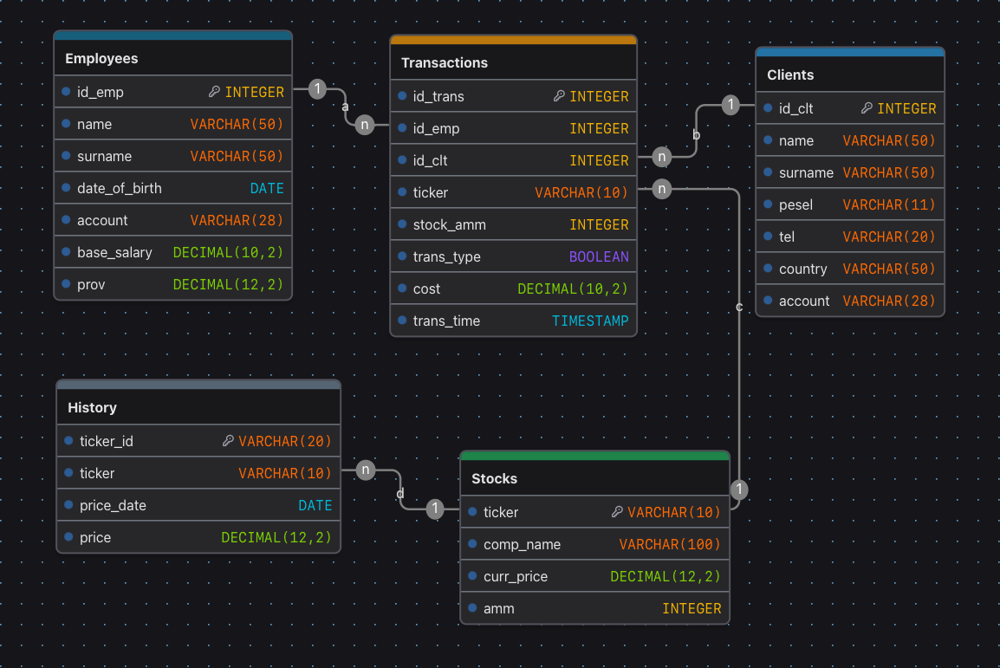

# Baza Danych Domu Maklerskiego

Projekt realizowany w ramach przedmiotu **Bazy Danych**. Jego celem jest zaprojektowanie i implementacja relacyjnej bazy danych obsługującej funkcjonowanie domu maklerskiego — w tym zarządzanie pracownikami, klientami, notowaniami spółek giełdowych oraz historią transakcji kupna i sprzedaży akcji.

# Schemat bazy danych

## Skład zespołu
* **Jan Malinowski**
* **Antoni Łukasiewicz**
* **Wiktor Leszczyński**
